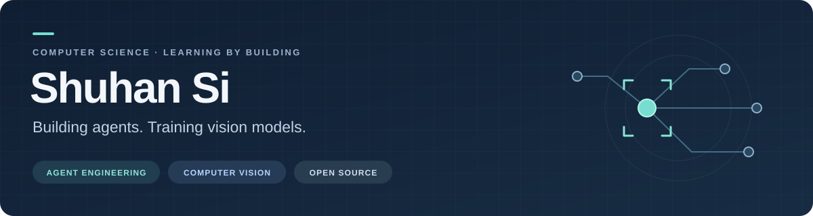

  

  <a href="#focus">研究与实践</a> ·
  <a href="#explore">项目入口</a> ·
  <a href="#open-source">开源参与</a>

你好，我是 **Shuhan Si**，一名计算机专业学生。正在围绕 **Agent 开发**与**计算机视觉模型训练**开展实践，也积极参与 GitHub 开源项目。

我关注从想法到实现的完整过程：理解原理、编写代码、运行实验，再通过测试和反馈持续改进。

### Focus · 研究与实践

| 方向 | 我在关注什么 |
| :--- | :--- |
| **Agent Engineering** | Agent Loop、工具调用与 MCP、上下文和会话管理；探索证据筛选、来源追溯，以及编程助手与任务的可靠执行。 |
| **Computer Vision** | 基于 PyTorch / MMDetection 开展目标检测训练与论文复现，关注半监督学习、跨域适应和实验评估。 |
| **Open Source** | 从阅读源码、复现问题到提交 Issue 和修复 PR，在实际协作中积累工程经验。 |

**常用语言与工具**　Python · TypeScript · PyTorch · MMDetection · Git

### Explore · 项目入口

- **[Evidence Sieve · 证据筛](https://github.com/2gg-bit/evidence-sieve)** — 面向 Agent 的证据筛选工具，探索去重、差异保留与来源追溯，支持 MCP / CLI 接入。
- **[MiniCode](https://github.com/2gg-bit/minicode)** — 轻量编程 Agent，探索工具、上下文与开发工作流。
- **[MerchantDesk AI](https://github.com/2gg-bit/merchantdesk-ai)** — 基于 Craft Agents 扩展的电商 AI 工作台实践。
- **[Computer Vision](https://github.com/2gg-bit/cv)** — 目标检测模型的复现、训练与实验记录。

更多 Agent 与应用实践见 [公开仓库](https://github.com/2gg-bit?tab=repositories)。

### Open Source · 持续参与

正在积极参与 Agent 生态的开源协作，近期已向以下项目提交修复 PR：

**[Agno](https://github.com/agno-agi/agno/pulls?q=is%3Apr+author%3A2gg-bit)** · **[nanobot](https://github.com/HKUDS/nanobot/pulls?q=is%3Apr+author%3A2gg-bit)** · **[Crawl4AI](https://github.com/unclecode/crawl4ai/pulls?q=is%3Apr+author%3A2gg-bit)** · **[OpenManus](https://github.com/FoundationAgents/OpenManus/pulls?q=is%3Apr+author%3A2gg-bit)**

参与方向包括工具调用与错误处理、文本和文件处理、抓取流程及边界情况。通过问题复现、Issue、修复代码和回归测试参与改进，关注改动能否被验证、能否帮助实际使用者。上方项目链接可查看我的 PR 及最新审查、合并状态。

[查看我的 Pull Requests](https://github.com/search?q=is%3Apr+author%3A2gg-bit+-user%3A2gg-bit&type=pullrequests) · [查看我的 Issues](https://github.com/search?q=is%3Aissue+author%3A2gg-bit+-user%3A2gg-bit&type=issues)

---

欢迎围绕 Agent 工程、视觉模型训练与开源实践交流。
